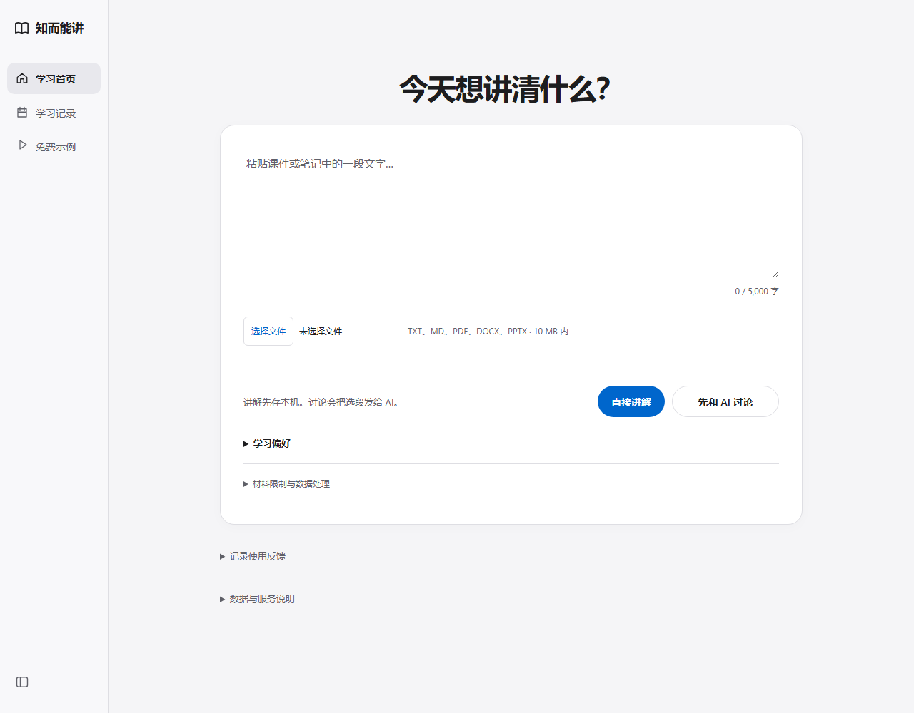

# 知而能讲

用自己的话讲一段材料，查清漏掉的条件，再换个情境试一次。面向用课件和笔记复习的学生。当前版本为 Windows 本地候选 **1.0.0-rc.1**。



## 开始使用

1. 在装有 Node.js 24 和 Edge 的 Windows 电脑上取得产品分支。已有本仓库时可直接进入仓库目录。
2. 双击 [Start-Study.cmd](Start-Study.cmd)。浏览器会打开本机工作台。导航中的 **免费示例** 提供循环队列和条件概率两节预写课程。
3. 用自己的材料练习时，粘贴一段笔记或选择文件，点 **直接讲解**。文字先存本机。可选录音或上传音频。要讨论、转写、诊断或生成开放练习，在启动服务前配置自己的 `OPENAI_API_KEY`，这些操作会消耗 API 额度。

```powershell
git clone --branch prototype/study-teachback-v0.1 https://github.com/BenCCCCCCCCC/Chat-Codex-Handoff.git
cd Chat-Codex-Handoff
.\Start-Study.cmd
```

服务地址是 `http://127.0.0.1:4317/`。终端也可运行 `npm start`。示例、粘贴和 TXT/MD 导入只需 Node。DOCX/PPTX 提取另需本机 Python，PDF 还需指定版本的 pypdf。控制窗口按 Enter 可正常停止，异常关闭可使用 [Stop-Study.cmd](Stop-Study.cmd)。[安装、配置与文件支持](study-teachback-app/README.md)

## 一次学习如何留下证据

| 你做什么 | 下次能找回什么 |
| --- | --- |
| 选择材料，编辑要讲清的目标并引用原句 | 当时的选段、来源版本和目标 |
| 打字或录音，核对后明确确认诊断 | 最初的表达、确认文字、报告中的材料引文。能定位的语音可回听 |
| 打开一条具体反馈，查原文、补学、只重讲这一点 | 同一问题的初讲和重讲。仅编辑转写会留下修订版本 |
| 换个情境，先作答再看依据 | 具体题面、首答和参考情况。题目有疑问时可暂停判断 |
| 回到首页或打开理解档案 | 上次的草稿、未完成的题，或本轮总结 |

独立检验只覆盖可在本机核对的有限规则。新题遮住材料和旧反馈，学习者提交首答时自报是否额外查阅。见过的题会标明普通练习。前提未定时可暂缓该项。开放题支持明确调用 AI 生成与反馈。更换材料版本后仍可回到旧报告。[理解档案与验证](docs/iterations/2026-11-26-understanding-record.md)

## 常见问题

- **长文件怎么继续读？** 在材料集中修订材料，重新选择文件并截取下一段。保留选段与可取得的页码位置。文件上限 10 MB，主题最多 12 份逻辑材料，单份和本次组合各限 5,000 字。扫描图片需先取得文本。
- **数据放在哪里？** 学习记录、原声和文字修订都在此浏览器中，默认保留七天。点击讨论会发送所选材料和对话，转写发送音频及术语，诊断发送材料和确认文字。费用显示为本机账本估算。
- **怎样长期留存？** 在当前主题导出备份，或在学习记录中导出。恢复时先预览，再建立一份新副本。支持 v1–v6。导出文件可能包含原声和讲解全文，请自行保管。尚未开始的新建材料草稿单独保存在本机，可复制其文字留存。
- **能反馈问题吗？** 在页脚展开“记录使用反馈”，选择环节和影响，写下现象，下载本地 JSON。是否分享由你决定。

## 版本与验证

[候选更新、截图及 90 秒演示](docs/iterations/2026-11-26-local-candidate.md) · [形成性研究方案](docs/research/v1-formative-study.md) · [同输入诊断质量协议](docs/research/quality-baseline-2026-11-18/PROTOCOL.md)。本轮使用合成材料和隔离供应商验证工程路径。真实学习者的次日迁移效果尚待研究。

开发按改动范围选择检查，仓库提供 `npm test`、`npm run test:browser`、`npm run test:extract`。使用隔离账本、Edge 配置和模拟响应。服务端固定模型、持久化和数据边界详见[技术说明](study-teachback-app/README.md)和[验证约定](docs/TESTING.md)。

产品分支为 `prototype/study-teachback-v0.1`。规划与动态交接位于 `meta/master-state`。[当前状态](https://github.com/BenCCCCCCCCC/Chat-Codex-Handoff/blob/meta/master-state/docs/master/CURRENT_STATE.md) · [交接](https://github.com/BenCCCCCCCCC/Chat-Codex-Handoff/blob/meta/master-state/docs/master/HANDOFF.md) · [0→1 路线](https://github.com/BenCCCCCCCCC/Chat-Codex-Handoff/blob/meta/master-state/docs/master/PRODUCT_0_TO_1.md)
