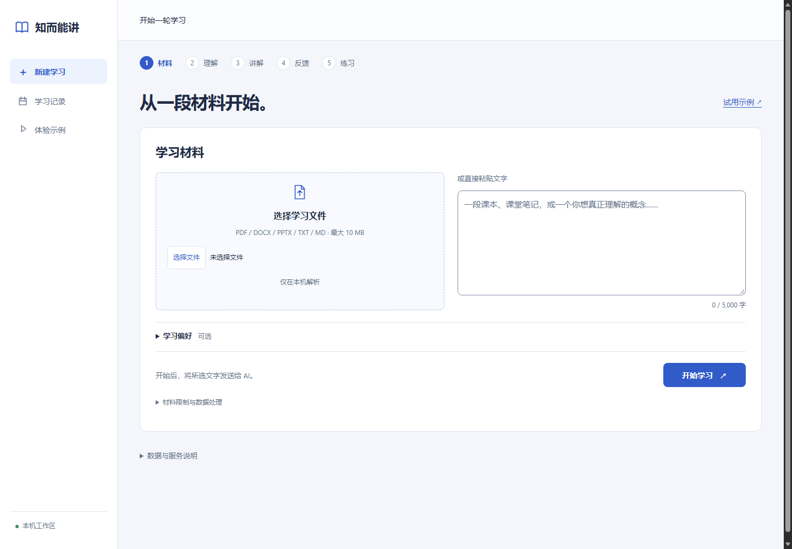
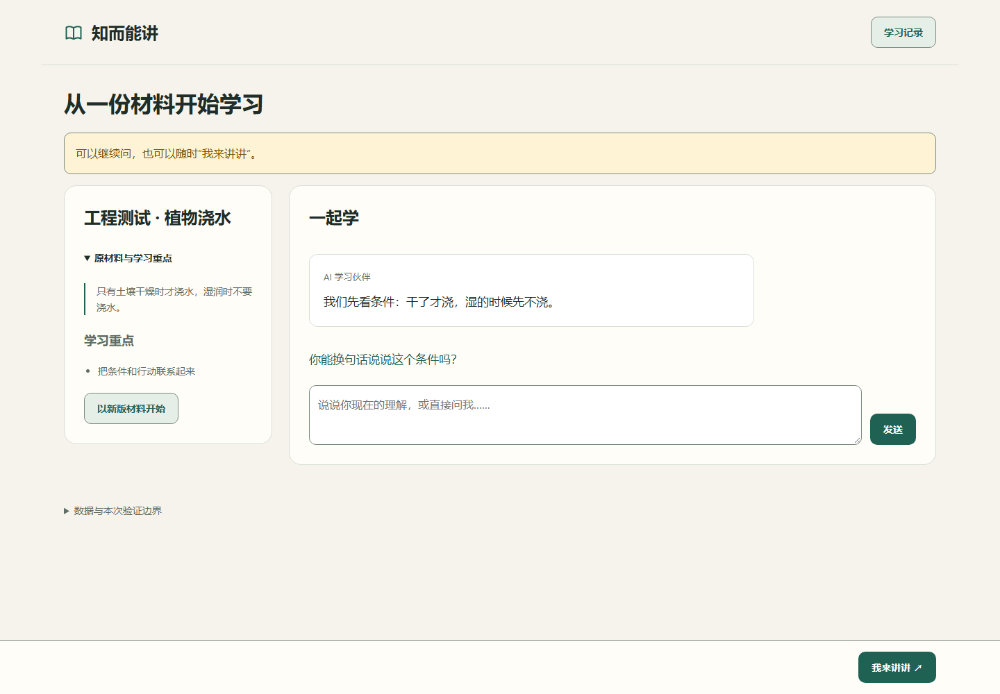
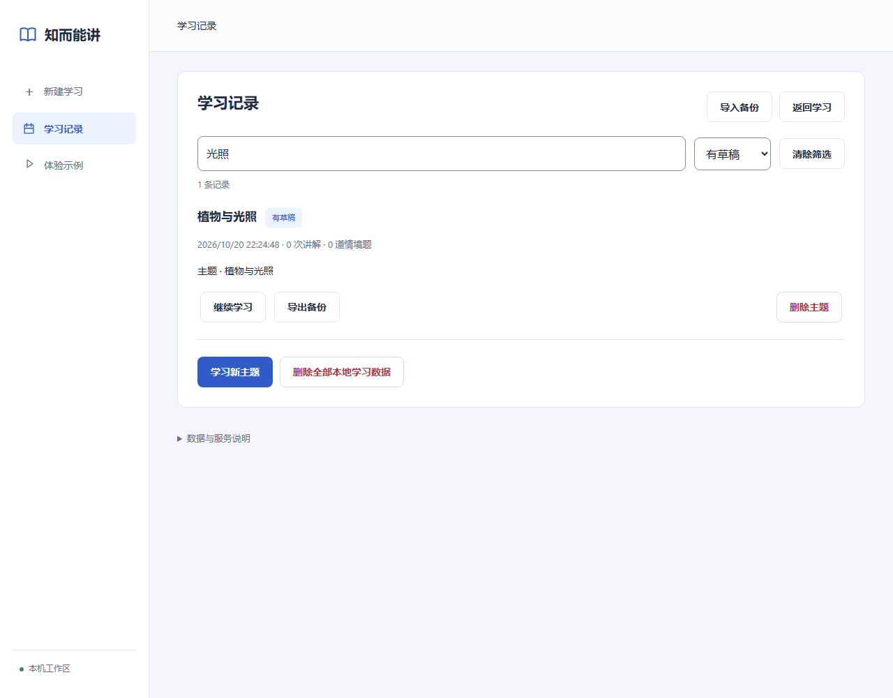
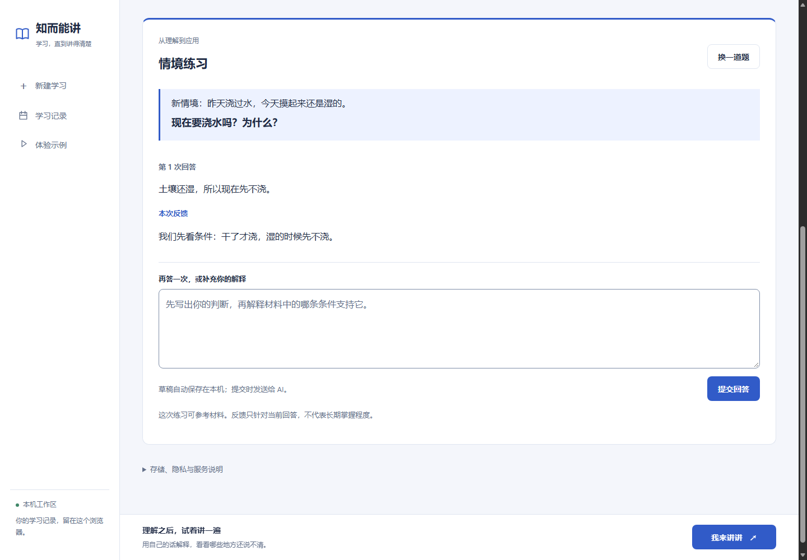
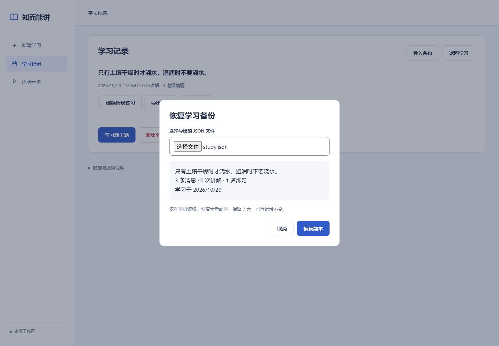
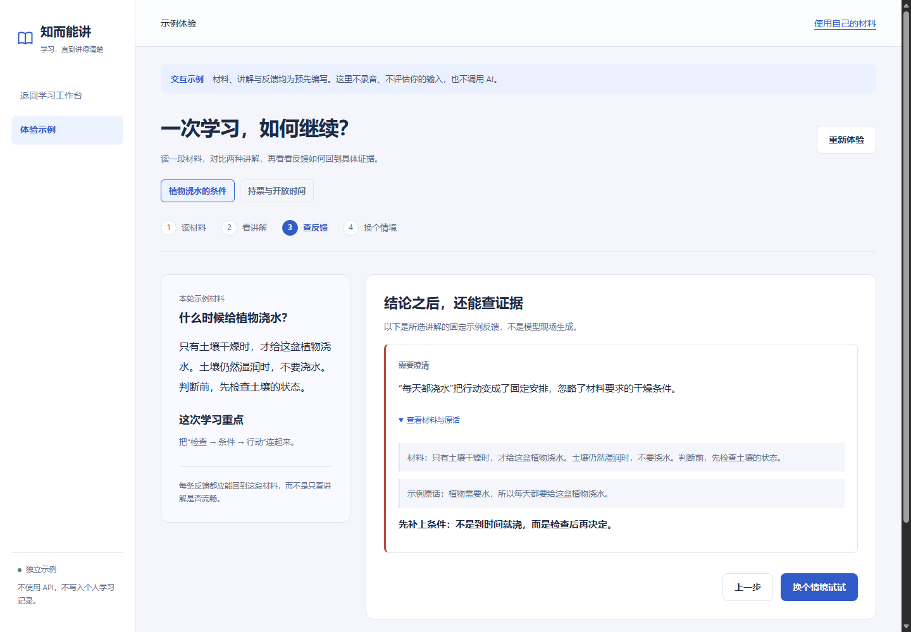

# 知而能讲 · Study & Teach-back

**把材料学进去，再用自己的话讲出来。**

面向个人学习与作品展示的学习原型：导入一小段材料，先理解，再录音讲解，核对转写后查看哪些内容已表达、哪些遗漏、哪些需要澄清。反馈关联材料、讲解原话和录音，方便回到具体问题继续学习。

当前是 Windows 本地应用。工程测试验证流程和数据边界；尚无跨课程、跨用户的学习效果验证。



*截图来自本地界面；下方学习工作区使用隔离测试中的材料和模拟响应。*

## 一轮学习

1. **放入材料**：粘贴文字或导入 MD、TXT、PDF、DOCX、PPTX。自动生成主题名，可选填写学习重点和已有理解。
2. **先学习**：围绕材料提问、解释和核对，不必先准备一份标准讲稿。
3. **我来讲讲**：在应用内录音或上传已有音频，保留原声；核对自动转写，可选回听、修正识别错误。
4. **查看反馈**：区分已表达、尚未表达、需要澄清和证据不足；文字修改后旧结果会标记过时。
5. **继续练习**：针对某一点补学、局部重讲，或进入独立的情境练习：先作答，再看反馈，还可以修改后再答。
6. **接着上次学**：草稿按主题保存；记录支持全文查找、类型筛选，重新打开时恢复最近主题及核对／练习位置。

重复查看相同文字的已有结果不会重新调用诊断。诊断进行时锁定提交和文字编辑，避免覆盖输入或并发重复请求。



普通聊天草稿自动保存在本机，等待回复时也可继续写下一句。长对话先显示最近 24 条，可加载更早消息或回到最新位置；向上阅读时，新回复不会把页面拉走。打开“上下文”可以保存对话要点，每次普通聊天参考材料、这些要点和最近最多 6 条消息。过长时先略去较早消息，并显示实际使用范围；重试沿用发送时的要点，不后台生成摘要。

学习记录可搜索材料、聊天、草稿、转写、修订与练习反馈，并按“有草稿／有讲解／有练习”筛选。点击命中片段可直达具体消息、转写段落或练习。历史转写只读展示并可回听原声，不替换当前文字。搜索在本机完成；自动保存仍遵循下方七天保留规则，长期留存请导出。



## 语音如何分析

支持应用内录音和上传已有音频。在“我来讲讲”中点“上传音频”，先在本机保存和试听，点击“开始转写”才发送音频。每段最长 3 分钟、文件最大 25 MiB；支持 WAV、MP3、M4A 等浏览器可解码格式。核心流程是：**本机保存原声 → 转写 API 转成文字 → 你核对并确认 → 文本模型对照材料分析 → 本机关联引用和原声**。

| 环节 | 执行位置 | 作用 |
| --- | --- | --- |
| 录音与声音检查 | 浏览器 | 保存原声，检查过轻、失真、中断和停顿候选 |
| 转文字 | OpenAI 转写 API，当前配置 `whisper-1` | 返回转写及时间位置，可能有识别错误 |
| 内容与逻辑反馈 | OpenAI Responses API，当前配置 `gpt-5.6-luna` | 根据材料和确认后的文字，判断已表达、遗漏、需要澄清或证据不足 |
| 引用与回听关联 | 本机程序 | 校验引文、绑定转写版本、提供原声回听；停顿观察单独呈现 |

核对中的文字会自动存为草稿，刷新、切换或备份恢复后可接着修改。只有点击确认才创建诊断文字版本；草稿不代表已经确认。新报告在折叠的“分析依据”中显示模型和请求标识，便于排查，同一文字的历史报告不会被覆盖。

录音或上传前可展开“转写术语”，填写易误识别的简短名称；每次讲解保存当时的词表，重试与备份恢复沿用它。提示是可选的，仍须核对识别结果。 本次两条音频的小样本比较中，Eee PC 恢复；无关词表没有插词，但零长度词增加，不能推为普遍质量提升。见[术语与反馈比较](docs/iterations/2026-10-21-terminology-feedback.md)。

转写默认提示使用简体中文，原始返回仍完整保留。展开“原始转写与回听”可点击词回听；词时间不可用时明确采用邻近范围或整段，不伪造精确时间。正确表达的反馈不再强制附修正建议，存在问题时才给具体下一步。见[本轮比较与限制](docs/iterations/2026-10-21-transcript-refinement.md)。

反馈里的短引文可回听“原话附近”：只有确认文字与原转写一致、引文唯一且能映射到词时间时才缩小范围；零长度词可借相邻有效边界回听，并标为“原话邻近范围，非精确词时间”；改过文字或定位不清时回听整段。多条“已表达”收在一个折叠项中。新反馈提示要求合并同一缺口，每条建议只安排一个动作；这是提示约束，不能保证每次输出均遵守。内容分析也核对数字／单位、术语含义、步骤和来源依据；仍需检查反馈，不能用引用有效代替判断正确。[真人语音与文本比较](docs/iterations/2026-10-21-natural-speech.md)记录了数字保留、Eee PC 术语差异及仍存在的零长度词时间。

这套流程主要分析**文字所表达的理解**，没有直接用声学特征给理解程度或流利度打分。上传原声、文件名和转写版本可随备份恢复。我们把转写字符差异和内容判断分别评估，保留失败结果与人工复核说明；小样本不代表自然口语准确率。详见[音频上传与质量评估](docs/iterations/2026-10-20-audio-upload-quality.md)。

## 把理解用起来

在底栏点“情境练习”，或在讲解反馈后点“试一个新情境”。每道题、每次回答与对应反馈分别保留，可以切回旧题继续作答。练习使用独立内容区，点“返回对话”可继续提问。

回答草稿自动保存在本机。请求失败会保留回答，刷新不会自动重试；再次提交完全相同且已有反馈的回答，会复用已有结果。练习记录也包含在本轮导出中，仍随主题遵循原有七天保留规则。



*此截图使用工程材料和模拟响应，验证真实产品流程，不代表模型反馈质量。实际出题与反馈需要 API key。*

## 失败后继续，备份后找回

普通对话失败时，问题与发送时的上下文会保留；点“重试原问题”继续，不重复添加用户消息。刷新不会自动发起请求。回复已收到但保存失败时，使用“重试保存”或导出保留结果。重试未完成请求会重新调用模型，可能再次计费。

主题顶栏或“学习记录”可**导出备份**。在记录页点**导入备份**，选择原有 v1 JSON，核对预览后恢复为新副本。材料、聊天、原声、转写修订、反馈与情境练习一起保留，已有记录不覆盖。文件仅在本机处理，最大 128 MB。

原始学习日期不变；恢复副本从确认恢复日起另保留七天。导出文件独立于应用内删除，需自行保存。



## 先体验一个例子

启动后打开 **`http://127.0.0.1:4317/demo`**，或点击“体验示例”。不需要 API key。

示例包含“植物浇水的条件”和“持票与开放时间”两组材料：读材料、对比两种讲解、展开反馈证据，再做一道情境题。材料、讲解和反馈均为预先编写，不评价自由输入、不录音、不调用 AI，也不读取或写入个人学习记录。



## 为什么做这个项目

“听懂了”与“能清楚解释”之间存在距离。本项目探索如何把一次讲解变成可核对、可补学的具体反馈。原声、转写修订和诊断版本保持关联；停顿等过程观察单独呈现，不作为“不理解”的证据。

同类产品已经广泛覆盖 AI 辅导、语音讲解和材料引用。接下来的研究重点是：**多份材料冲突时，如何避免凭空判错，并确定应先补哪一点**。这是待验证的方向，当前产品仍使用单份有限材料，不宣称已有竞争优势。

详见[产品与机制调研](docs/research/2026-10-20-landscape.md)、[设计与技能资料](docs/research/design-and-skills.md)、[工作台设计依据](docs/research/2026-10-20-workspace-design.md)和[迭代路线](docs/ROADMAP.md)。

## 本地运行

已验证环境：Windows、Node.js 24、Python 3.14、Microsoft Edge。Node 运行时没有第三方 npm 依赖；文件提取使用固定版本 pypdf 6.18.0。

```powershell
git clone --branch prototype/study-teachback-v0.1 https://github.com/BenCCCCCCCCC/Chat-Codex-Handoff.git
cd Chat-Codex-Handoff
py -3 -m venv study-teachback-app/.venv
study-teachback-app/.venv/Scripts/python.exe -I -m pip --isolated install --index-url https://pypi.org/simple --only-binary=:all: --no-deps --require-hashes --disable-pip-version-check -r study-teachback-app/requirements-extractor.txt
```

界面与独立示例可直接运行 `npm start`，打开 `http://127.0.0.1:4317/`；只体验示例无需 Python 提取环境。实际 Tutor、转写和诊断需要在服务进程环境中配置自己的 `OPENAI_API_KEY`，并承担对应 API 费用。没有 key 时不提供真实模型反馈，不会悄悄替换成模拟结果。

已配置环境也可双击 [Start-Study.cmd](Start-Study.cmd)。停止与异常恢复见 [Stop-Study.cmd](Stop-Study.cmd)。[详细安装与数据说明](study-teachback-app/README.md)包含文件限制、启动器行为与现有模型配置。

## 不花费 API 额度的验证

完成 Python 提取环境安装后，在仓库根目录运行：

```powershell
npm test
npm run test:extract
npm run test:browser
```

测试包装器使用模拟凭据、模拟 provider、独立账本和独立 Edge profile，阻止测试 Node 进程访问外部网络。浏览器回归使用合成音频，不打开物理麦克风。日志写入 ignored `artifacts/`，不覆盖已有记录。

[GitHub Actions](.github/workflows/offline-tests.yml)在代码 PR 上运行 Node 回归，按改动选择浏览器和提取器检查；纯文档修改不触发，不再对同一提交同时执行 push 与 PR 两轮检查。以上命令是可选验证范围，日常不要求全部重跑。遵循[按影响验证的约定](docs/TESTING.md)。[公开整理](docs/iterations/2026-10-20.md)、[工作台迭代](docs/iterations/2026-10-20-workspace-ux.md)与[学习流程迭代](docs/iterations/2026-10-20-practice-resume.md)记录实际结果；浏览器测试通过不代表模型准确率或教学效果。

## 数据与能力边界

- 原文件在本机提取；点击开始学习才发送选定材料。转写会发送音频及你填写的术语，内容诊断会发送材料及确认的文字到模型服务。
- 学习记录与原声保存在浏览器 IndexedDB，默认七天过期；可导出和删除。
- 单轮材料最多 5,000 字；输入文件最多 10 MB；无 OCR。复杂版式请核对提取预览。
- 现有成本账本使用历史固定费率估算并限制请求；不能代替服务商账单或账户消费限制。
- 尚未实现多人账户、云同步、生产多文件工作区、跨标签页持久去重，以及经过验证的总体掌握度评分。

## 项目结构与协作

| 路径 | 用途 |
| --- | --- |
| `study-teachback-app/` | 原生 HTML/CSS/JavaScript 前端、Node 服务、Python 提取器与测试 |
| `study-teachback-app/fixtures/` | 可分发合成音频，不含个人录音 |
| `docs/research/` | 有来源的竞品、设计、机制和技能资料 |
| `docs/iterations/` | 按批次记录的审核、验证与交接 |
| `handoff-kit/`、`acceptance-p0/` | 保留的历史开发工具，不是学习产品入口 |

仓库名称沿用早期开发工具名称；当前产品分支是 `prototype/study-teachback-v0.1`。动态交接仍在 **`meta/master-state`**：
[CURRENT_STATE](https://github.com/BenCCCCCCCCC/Chat-Codex-Handoff/blob/meta/master-state/docs/master/CURRENT_STATE.md) · [HANDOFF](https://github.com/BenCCCCCCCCC/Chat-Codex-Handoff/blob/meta/master-state/docs/master/HANDOFF.md)。

按有意义的改进批次提交，使用 Issue/PR 留下问题、决定和验证结果。代码公开与开源许可证是两件事；当前尚未选择项目许可证。

*English: A local, source-grounded study and spoken teach-back prototype. Import learning material, explain it aloud, review the transcript, and follow evidence-linked feedback. Intended for personal learning and a product portfolio; learning efficacy is not yet established.*
