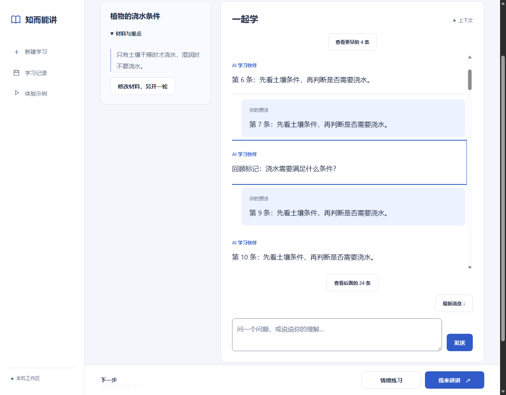
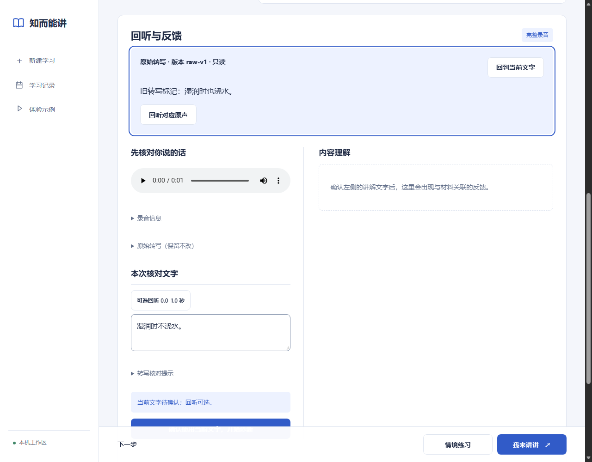

# 搜索定位、对话上下文与语音核对

跟踪：[Issue #12](https://github.com/BenCCCCCCCCC/Chat-Codex-Handoff/issues/12)。合并与 CI 的最终状态见 `meta/master-state`。

## 本批实现

- 搜索结果保留逐项位置：消息下标、讲解／转写版本／片段 ID、反馈索引和练习引用。点片段直接跳转并高亮；前三处展开，其余按需展开。旧消息先载入附近 24 条，可向前／后继续阅读，也可回到最新。保留返回搜索入口和原筛选条件。
- 命中当前转写可直接定位输入框；命中旧版本时打开只读片段并关联原声，不把历史文字写回当前版本。旧反馈也只读展示，缺失内容不伪造回听时间。
- “上下文”内提供最多 1,000 字的手动对话要点，自动保存并随备份恢复。发送时固定要点快照，未知结果重试使用原快照。提示明确这些是用户整理的讨论上下文，不是权威来源或掌握证据。
- 长对话请求保持最近最多六条消息。达到既有 24,000 输入保守上界时，从最早整条历史开始移除；材料、当前问题和要点不静默裁剪，必需内容超限仍拒绝。返回实际使用／省略条数，在折叠区展示。将 `/api/teach` 本地请求体上限调至 128,000 字节，允许合法中文历史先到达选择环节；字段上限和 API 费用上界不变。没有后台摘要或额外模型调用。
- 转写编辑复用草稿保存器，按当前版本独立保存 `transcriptDraft`。刷新、导航、导出／导入可继续核对；确认后才创建修订版本并发起内容诊断。删除取消待写入内容，恢复保存不会重复调用模型。
- 新报告保存分析方式、模型、reservationId 和 provider requestId；ASR 记录也保留 provider requestId。界面把追踪信息放在“分析依据”折叠区。历史报告缺失的归因保持未知，不能用这次实现反推 Phase 3B 的两份历史报告。

页面延续[已有设计资料与取舍](../research/2026-10-20-recovery-and-density.md)：结果可直接操作，说明与追踪信息按需展开。转写区去掉重复说明，不增加长期掌握分、监控卡片或说明面板。使用 OpenAI Docs 技能核对了 [API 请求标识文档](https://developers.openai.com/api/reference/overview#debugging-requests)：`x-request-id` 用于请求追踪；它不证明某份反馈正确。

## 核心语音机制

当前入口是应用内 MediaRecorder 录音，并未实现外部音频文件上传。本机先保存原声、解码、检查过轻／失真／中断并计算过程候选，再归一化为单声道 16 kHz WAV。有效音频注册后发送 `/v1/audio/transcriptions`，当前配置 `whisper-1`，请求中文及词／段时间。原始转写独立保留。

学习者核对并明确确认后，另一笔 `/v1/responses` 请求将学习材料和确认文字交给当前配置的 `gpt-5.6-luna`。内容判断不接收声学指标。模型返回结构化 findings，本机验证来源／版本／逐字引用，关联原声回听并保存报告。长静音或短停顿只作独立过程观察；当前过程确认在本机完成，不额外调用语义模型。

因此核心理解分析依赖**确认后的文字**。本轮优化的是核对连续性、恢复、检索和可追溯性，尚未改变 ASR 或内容模型，也没有宣称准确率提高。

下一步若要提高质量，先把“转写错了”和“文字正确但判断错了”分开评估：固定含否定词、数字、必要／充分条件、自我修正及课程术语的自愿样本；同时保留原声、原始 ASR、人工确认文字和所有报告。分别比较转写错误、错误／遗漏判断、引用准确性及重复输入稳定性。先做小样本基线，再决定术语提示、分段策略或模型替换，不以一次好结果作结论。真实实验须另定样本与新增预算；本批没有动用真实调用。

## 按影响验证

- 本地定向 Node 26/26，覆盖位置／版本引用、provider 历史选择和请求追踪、备份草稿、重试快照，以及既有确认和保存边界。
- 聚焦 Edge 三条流程 3/3：100 条消息中的早期定位与前后加载、旧转写只读；要点保存／刷新／原快照重试；核对草稿刷新与备份恢复、确认后的新版本和报告请求绑定。
- 使用合成数据、合成 WAV、独立浏览器／账本和桩 provider；无个人麦克风、真实 ASR／模型请求。生产账本 hash 仍为 `1d6a29631982daf6cd540622f2dabee3d2c48b24dbda8a8879dbb2ca7b215a21`。
- 已查看桌面和手机截图，消息高亮调整为内描边，避免滚动区裁掉边缘。发现中文合法输入可能先撞本地请求体限制，扩大有界容纳范围并调整现有测试；该后续代码由批次 CI 验证，不在本地再跑全套。
- 添加 `--context-only` 聚焦入口。去掉旧浏览器用例锁定核对提示长句的断言，保留实际可确认、版本与回听行为；没有新增文案／CSS 快照矩阵。

本地收据（ignored）：`artifacts/study-teachback/diagnosis-state-ux-01/node-1792498099830-VFZvfu`、`browser-1792498109834-vPD9Mk`。完整 Node／Edge 回归由本批 PR CI 执行，最终状态与链接写入 canonical 交接。

截图是实际页面与合成测试内容。手机上下文截图为 `docs/images/study-context-mobile.png`。

## 交接重点

本批需求已实现，不再把命中跳转、对话要点或核对草稿列为未开始。用户可自行编辑要点；尚无自动摘要，也不宣称完整历史始终进入请求。强制终止前尚未完成的写入、跨标签页并发和服务端持久请求去重仍未解决。七天保留、恢复副本、原声／版本不覆盖与费用边界沿用既有规则。

Issue #3 的固定输入基线研究继续保留。新的请求追踪只适用于新报告；两份同输入历史结果均须保留，不把本批工程验证当作教学效果、自然语音识别率或过程检测准确率证明。
