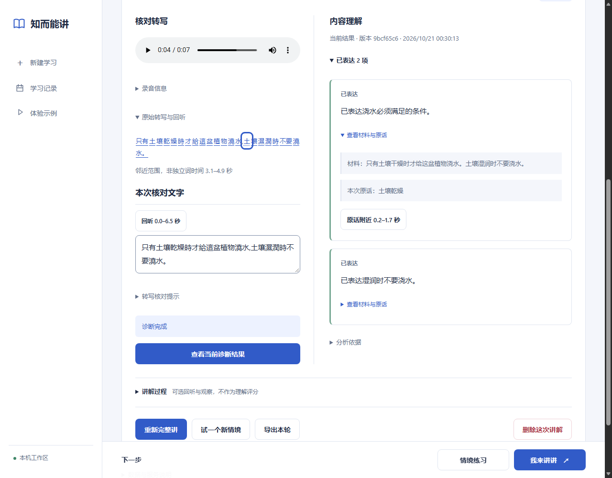

# 真人语音、数字术语与引文回听

跟踪：[Issue #18](https://github.com/BenCCCCCCCCC/Chat-Codex-Handoff/issues/18)。
合并提交与 CI 状态写入 `meta/master-state`。

## 产品变化

- 内容反馈中的短引文可以回听“原话附近”。确认段必须与原始段的文字及边界完全一致，引用在段内唯一，词文本能顺序映射且对应时间可用；取相关词的首尾时间，前后各留至多 0.3 秒，不超出原段。否则回听整段。更正文字不会被强行对齐，缺失内容没有音频位置，不改原始时间戳。
- 内容提示补充相关数字／单位／范围、否定、术语含义、机制与步骤核对，区分来源支持、冲突与无法判断；不要求每个细节都背下来。保留最终自我修正、来源／版本绑定和 supported 无修正建议的要求。
- 去掉必须使用固定条件句式的要求，改为一两句具体解释和一个下一步。模型与 schema 没变，历史反馈也不改写。
- 实验显示正确内容可能被拆成多张卡，因此界面把多条“已表达”默认折叠，展开仍能逐项查看依据与回听。错误／遗漏继续直接显示。核对提示与播放按钮删去重复文案，没有增加常驻说明区。

截图来自隔离浏览器中的工程材料和模拟反馈，原文沿用历史合成转写；不是本轮真人 API 结果界面。
[手机折叠状态](../images/study-feedback-folded-mobile.png)保留过时报告提示和草稿状态。

这仍是 **原声 → Whisper 转写 → 用户校对文字 → Luna 对照材料分析**。
原声在本机保存，内容模型不接收声学特征。数字、术语和逻辑反馈作用于确认文字；
不能据停顿、音色或口音推断理解程度。

## 获批比较与完整结果

用户批准[固定方案](../research/2026-10-21-natural-speech-plan.md)，最高 **US$0.15**：
三条公开许可真人录音各一次转写，四条固定文本分别跑基线／候选提示，共 **11 次调用**。
全部输入、配置、输出、用量与逐例复核见 [JSON 报告](../research/natural-speech-live.json)。
音频的 CC BY 4.0 归因、版本、原始／转换 hash 见 [样本说明](../../study-teachback-app/fixtures/natural-speech/README.md)。

两条 FLEURS 是真人朗读，参考来自朗读稿，未独立核实每个实际发音；第三条 MInDS-14 是情境引导口语，
其参考文字来自 Google ASR，不能当成人工标准答案。样本在调用前按数字、混合英文术语与口语特征选定。

| 样本 | 相对参考文字的观察 | 时间字段 |
| --- | --- | --- |
| FLEURS 12.12 秒，电脑产品 | 严格字符差异 3/52；`Eee PC`→`ePC`，`及`→`其`。华硕、2007、IT 保留，Eee PC 关键项未保留 | 45 个词，0 个零长度 |
| FLEURS 13.86 秒，桥梁数据 | 严格字符差异 0/37；15 米、2011 年 8 月、2017 年 3 月和垂直净空均保留 | 30 个词，1 个零长度（“项”） |
| MInDS 17.152 秒，账户查询 | 不计算准确率；结果有余额、APP、不能使用，但与旧自动转写在重复、主语及结尾上不同，未判哪份正确 | 44 个词，4 个零长度 |

严格 CER 保留简繁与数字写法差异。关键项另按预先声明的别名检查，数字有边界，
避免将 115 米当成 15 米；这只检查词项出现，不检查数字角色／完整含义。
时间均通过结构校验，但没有独立人工边界，**不报告时间定位准确率**。
范围回听是使用体验改进，不等于修好了 ASR 对齐。

| 固定文本 | 共同表现 | 候选相对基线与限制 |
| --- | --- | --- |
| 50 米误说成来源的 15 米 | 均指出数值冲突，保留正确日期 | 两张卡变一张；修正建议仍偏向给答案后复述 |
| 缓存定义、读取步骤与自我修正 | 均接受最终修正，supported 的 repair 均为 null | 候选拆成三条，解释共 87 字，基线 63 字；页面折叠处理，不掩盖原报告 |
| 为延迟通车编造原因 | 均用 unknown，不把无证据当成原因不成立 | 解释 59 vs 74 字；候选建议仍一次问两件事 |
| 备份必要条件被误推为充分 | 均指出方向错误 | 候选去掉固定句式，但建议仍与解释重复，未消除模板感 |

两臂各 **4/4** 符合固定判断预期、各 **4/4** 通过引用／版本校验。
这是四例结果，不是稳定准确率。候选保留较具体的检查范围及开放表达，采用为当前配置；
**没有测到判断准确率提升，也没有证明泛泛建议已消失**。没有再利用剩余额度调参。

累计保守预留 **US$0.084016**，账本新增费用估算 **US$0.0080848**，新增未结算 0。
费用按公开费率保守估算，不是供应商最终账单；无重试、充值或个人录音上传。
原始收据保存在 ignored `artifacts/study-teachback/natural-speech-01/live-quality.json`，
SHA256 `cb7aaf601c70b3ec2edf3f6387b192c01b78103c75c60cd19e1c8a63dbfd5876`。

## 验证、交接与下一步

本地定向 Node **27/27**：新增两个行为用例，覆盖引文范围与更正／重复／不可用词的回退，
以及数字边界、参考文字来源不被误算成准确率。复用备份和确认流程检查。
首次检查因精简文案后的旧字符串断言失败，更新已有断言后通过，没有增加文案测试。

聚焦 Edge **1/1**：引文键盘播放、真实媒体覆盖、词与邻近范围回听、草稿刷新、原文不改、
多条已表达默认折叠、390px 无横向溢出。API 实验后新增折叠行为只复验该浏览器流程。
完整 Node／Edge 留给 PR CI，提取器无变更不重跑。

本机收据：`node-1792502767575-CExS1K`、最终 `browser-1792503012016-j8MMNk`，
均在 ignored `artifacts/study-teachback/diagnosis-state-ux-01/`。
离线检查未改变生产账本；真实实验后账本 SHA256：
`b1c8d360f7849ef165239ae9faa975f1ad1514daeef5f2f3501404aa4a6983a7`。

下一步优先：为自愿自然讲解建立人工核对文字与少量人工时间边界，加入领域术语／数字角色错误，
再比较当前 Whisper 与支持所需时间定位的方案。若使用术语提示，必须来自用户明确提供的词表，
不能把教材答案塞入转写以制造“更准确”。对内容反馈继续检查单一追问、重复解释与不同概念的误判；
新真实调用先另报方案与预算。当前 3 条语音和 4 条文字不支持自然对话泛化结论。

Phase 3B 两份历史报告、来源裁决研究、七天保留、v1 备份及全局费用边界保持不变。
