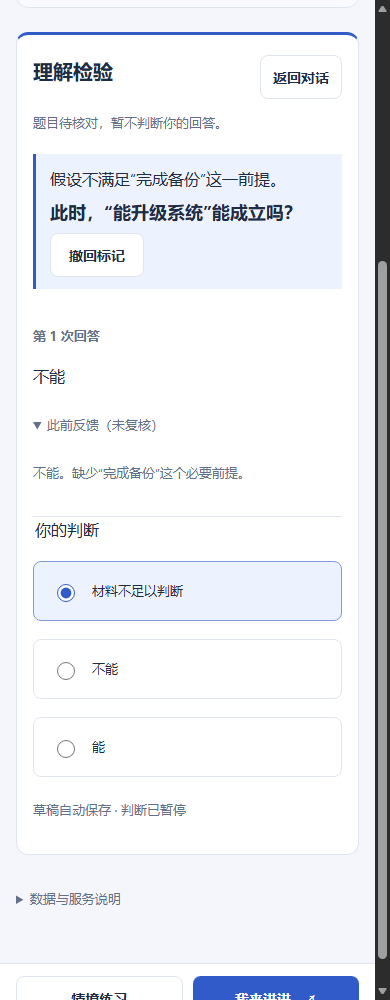

# 真实教程覆盖与疑问题目处理

跟踪：[Issue #27](https://github.com/BenCCCCCCCCC/Chat-Codex-Handoff/issues/27)。合并、CI 和最终状态集中记录在 `meta/master-state`。

## 发现：现有本机句式规则不覆盖这批教程

按[离线方案](../research/2026-10-21-real-material-plan.md)，固定 8 段中文原文：Python 3.14 官方教程 4 段、MDN 4 段。保留原句、上下文限定和例外，未重写为“只有…才…”等模板。每个目标引用完整摘录，给现有本机入口最有利的来源条件；没有运行上游诊断，也没有用真实学习者数据。

| 来源 | 检验目标 | 实际生成题 | 作者参照题的强度与限制 |
|---|---|---|---|
| Python range | 终止值与负步长 | 无 | 单步规则应用，可猜中 |
| Python remove | 重复元素只移除首项 | 无 | 新列表上的规则应用，未测异常分支 |
| Python finally | 异常传播及控制流例外 | 无 | 给定分支判断，未测独立编程 |
| Python with | 异常路径的关闭行为 | 无 | 与解释接近，检验强度弱 |
| MDN 严格相等 | 类型不同的相似值 | 无 | 给定类型后的单步应用 |
| MDN disabled | 已有值是否提交 | 无 | 单个后果，未测所有控件行为 |
| MDN 隐私存储 | 关闭后的数据生命周期 | 无 | 限定摘录与隐私模式，不能推普通模式 |
| MDN border-box | 从实际宽度扣除两侧 | 无 | 新数值计算，未测真实布局约束 |

**覆盖率 0/8；生成题有效性 N/A（没有生成题）；学习效果未评估。** 八次均返回当前句式不支持，完整返回保存于 [real-material-offline.json](../research/real-material-offline.json)。不能把拒绝出题记为有效题或判题正确。没有用新增正则去贴合本批样本。

这比“模板样例通过”更接近编程自学，但仍是便利样本：只有两个文档体系，选材者知道规则，不能外推为所有中文教材的覆盖率。为了区分题目有效性与学习效果，为每例另写一个有效参照和一个故意无效题，连同依据、修复方向和强度说明保存在 [corpus](../research/fixtures/real-material-corpus.json)。**参照题由本次编码助手编写并复核，不是产品输出或独立教师评审。** 多数参照也只能提供较弱的单步应用证据，不把换数字或换场景当作深度理解已证实。

典型无效题包括：将 remove 不存在元素说成返回 -1、忽视 finally 中 return 的例外、要求从 disabled 推出数据库删除数、从隐私模式推出普通模式保留天数、未给 padding 却要求 border-box 内容宽的唯一数值。处理对象应是题目的前提或信息缺口，不是责备回答“不完整”。

材料选段及许可见 [fixture 说明](../research/fixtures/README.md)：Python PSF-2.0、MDN CC BY-SA 2.5；原文与人工编写部分分开标识，项目代码许可仍未选。

## 交付：暂停可疑题的判断，保留记录

所有练习题旁新增“题目有疑问”。点击先保存待落盘草稿，再进入待核对状态：

- 隐藏提交入口；流程层也阻止判答，不创建答案成绩、不调用 API。
- 草稿继续可编辑，已有回答保持原样；此前反馈折叠为“未复核”，不显示旧正确／错误标签或答案依据。
- 标记随刷新与 v1 备份保留，搜索反馈标为“待复核反馈”，定位时可展开历史文本。
- “撤回标记”只撤销用户自己的疑问状态，不宣称题目已被系统验证，也不会立即判答或产生调用。
- 本机发现保存题目与材料／任务快照不一致时，自动进入待核对状态，保留选择，不把契约错误转成答错。此状态不能靠撤回绕过；损坏任务的备份仍按原规则拒绝导入。

这不是自动的语义审题器。开放 AI 题仍可能生成无效题，用户尚未标记时也可能给出错误反馈；本批改善的是发现疑问后的停止和保存路径。没有启用上一轮失败的 AI 审题／评分候选，也没有暗中改写历史结果。没有后台审核队列或自动换题，普通“换一道题 · AI”仍须主动操作。

无题页面改为“暂未生成合适的检验题”，不再用材料不足暗示学习者的问题。既有旧题选择、返回对话、补学和重讲入口保留。



截图来自隔离工程材料；历史反馈由测试主动展开，默认折叠。只演示保存／暂停流程，不证明规则判断质量。

## 验证与成本

本地定向 Node **41/41** 通过；扩展原有 Edge **1 条整合路径**，覆盖立即标记时落盘、重载保留选择、无法继续提交、历史结果折叠、撤回和 390px 布局；截图已查看。没有新建重复全量测试，本机不重跑未改套件，完整回归交给 PR CI。

新增的核心回归使用真实盒模型摘录与缺少 padding 的题：即使历史反馈已错误要求 116px，标记后也不新判答，疑问文字与原历史不丢失。测试使用模拟响应，仅证明状态与调用边界，不证明模型识别该错误。

离线评估只读本机引擎，**API 0 次、费用 US$0**。相关测试用合成凭据、回环服务与隔离账本，生产账本前后 SHA256 相同：
`9f23a117f27c0d279872885bdf074d48cbf369e0beec44480d2644c2b148c67e`。

材料 SHA256：`acbcd9074e06323229af4c144e4db7b88e428faa44b11ba622533b79b6b1c30d`。
出题器 hash 及逐例输入／输出在离线 JSON。复算命令：

```powershell
node study-teachback-app/evaluate-real-material.mjs
```

本地测试收据位于 `artifacts/study-teachback/correctness-hygiene-01/`：
`node-1792513874677-CBofZw`、`browser-1792513882984-5z71e9`。

## 下一步

先解决题目／标准如何被明确审阅或编辑，再考虑扩展生成。可在本次冻结语料上设计“先判断题是否成立，再判断答案”的独立实验，覆盖正确质疑、猜测答案和错误标准，另留未参与调试的材料。必须另提方案预算并获批；本轮没有真实调用授权，历史额度不延用。需要真实学习者数据才能研究题目区分理解、迁移或长期保持的能力。
