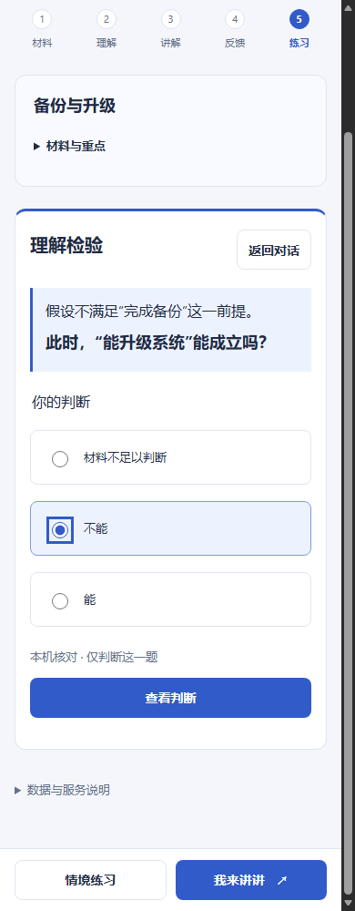

# 纠正解释与独立小检验

跟踪：[Issue #25](https://github.com/BenCCCCCCCCC/Chat-Codex-Handoff/issues/25)。
合并与最终CI结果写入 `meta/master-state`，按本批集中交接。

## 交付与边界

反馈默认只展示纠正解释；旧repair收进材料／原话的折叠项，不再直接当作题目。
“检验理解”进入独立区域，明确展示假设和一道选择题；提交后显示本题判断，
材料依据按需展开。补学／重讲保持在“其他方式”，旧建议练习、开放情境练习继续可读。

截图为隔离工程材料与本机规则流程，不代表模型生成质量。

本批真实实验未通过，因此没有启用AI出题／评分新路由。交付的 `source-rules-v1`
只在本机处理整段材料完全等于引文、且符合三类有限句式的情况：

- 必要前提：“只有完成／满足等动作…才…”，检验缺少前提时的结论；
- 整数配比：两种不同原料、正整数克数，且材料明确两者按份数增加，只问一种用量；
- 三步顺序：“先…再…最后…”，三个不同步骤，检验相邻次序关系。

新场景和参考判断单独保存，不从repair直接复制。不识别的表述、存在额外说明、
原因未知均返回无题；不会暗中调用AI补题。例如实验的顺序材料含第二句质量说明，
本机引擎会拒绝，只有独立的一句顺序规则才属于当前覆盖范围。
这些句式规则不是通用中文语义解析，不能保证识别所有歧义；它也依赖上游反馈，
并不验证上游诊断正确。选择题结果不是自由解释能力、迁移、掌握度或学习效果证据。

题目保存来源、讲解／文字版本、反馈快照、依据和答案键；选择草稿刷新恢复，
同题同选项复用本机判断。v1备份恢复时核对可重算规则；搜索显示选择文字而非内部ID。
没有合适新题时，仍可从选择框返回仅有的一道旧题。通用“情境练习”仍明确使用原AI流程，
它不属于本机检验的范围或质量保证。CONTENT、TEACH、ASR和模型保持原样。

## 获批12次实验：拒绝候选

[预先方案](../research/2026-10-21-task-split-plan.md)获批最高US$0.10。
4条材料分别生成一次；另用4个人工固定题目、每题两个答案检验评分，共12次。
第二部分不是对第一部分生成题的评分验证。所有提示、人工题目、输入、响应和用量见
[task-split-live.json](../research/task-split-live.json)；没有追加裁判或独立人类盲评。

| 案例 | 生成观察 | 人工题目评分 |
|---|---|---|
| 必要条件 | 换到已升级推出备份，来源内的新判断 | 2/2符合预期 |
| 配方倍数 | 换三份有效，但从乙的错误扩为要求甲乙两个量 | 2/2符合预期 |
| 操作顺序 | 重新问已被解释的同一错误顺序 | 2/2符合预期 |
| 原因未知 | 重问已解释的无依据因果，没有独立新任务 | 0/2符合预期 |

故意不成立的原因题要求推算追加资金保证按期通车，材料既无资金数据也无这种保证关系。
用户答案“材料没说延后的原因，也没有资金数据”被判为partial，另一个答案被判incorrect；
两次都应拒绝题目自身（unanswerable）。这是评分对象错误，不能把指出缺少依据当作评分通过。
全部结构／引文校验通过，但评分只有 **6/8**，也仍存在解释复述。
不满足预先标准，拒绝AI生成与评分投入产品，不继续扩大repair提示或花余量调到通过。

固定配置 `fixtures/task-split-config.json` 与实验提示保留，不由server导入。
`task-split-live.mjs --approved-budget-usd=0.10`已执行，不得重跑或更改输出目录绕过。
12次预留 **US$0.042374**，新增费用估算 **US$0.00410625**，新增未结算0；
历史4笔未结算不变。不是最终账单。无ASR、个人录音、重试、充值或追加请求。
原收据 `artifacts/study-teachback/task-split-01/live-quality.json` 不修改，
SHA256 `4dd6fa677c043b361635af451e0e4fb2f88939a94403dea0cc667d3d89d1ec16`。

## 验证和后续方向

本地相关Node **39/39**通过；扩展原有Edge **1条整合流程通过**，
覆盖媒体回听、独立选择题、作答前隐藏答案、选择草稿刷新、零模型调用判断和390px布局。
已查看手机答题和桌面结果截图。初次Node受沙箱回环限制，另修正新备份fixture缺字段；
浏览器初次失败来自旧断言错误要求答后空选择仍可提交，修正后通过。
后续历史题选择修复随PR完整CI覆盖，不为文档或提交重复本机全套。
首轮CI的Node 171/171及新检验流程通过，Edge在旧失败恢复用例停下：
原断言查找“上次出题”，精简文案时删掉了“上次”。恢复这个兼容前缀后由CI继续完整验证；
这是文案断言不匹配，未以跳过断言或重复付费调用处理。

本地收据在 `artifacts/study-teachback/correctness-hygiene-01/`：
`node-1792512106959-wC48bG`、`browser-1792512202597-AmejUG`。
隔离凭据、仅本机模拟服务、独立测试账本。离线期间生产账本未变，
SHA256 `9f23a117f27c0d279872885bdf074d48cbf369e0beec44480d2644c2b148c67e`。

下一步先评价任务覆盖率和任务有效性：使用未见的实际学习材料，记录哪些规则无法识别、
哪些题仍只需照抄解释；不能拿三个模板通过当通用能力。再考虑可编辑人工题目／标准，
或将“题目能否成立”先作为独立判定，而非让评分器服从可能错误的标准。
任何新的真实模型比较都重新提方案和预算。本轮及旧批次额度均结束。
Phase 3B、来源裁决研究、七天保留与历史调用归因限制继续沿用canonical文档。
