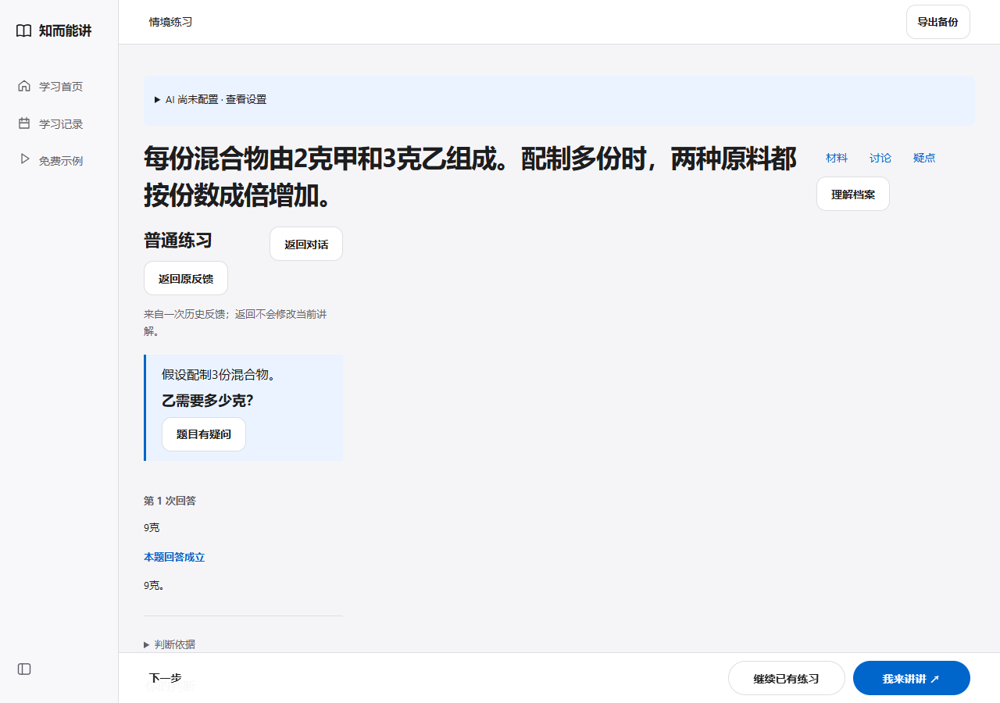
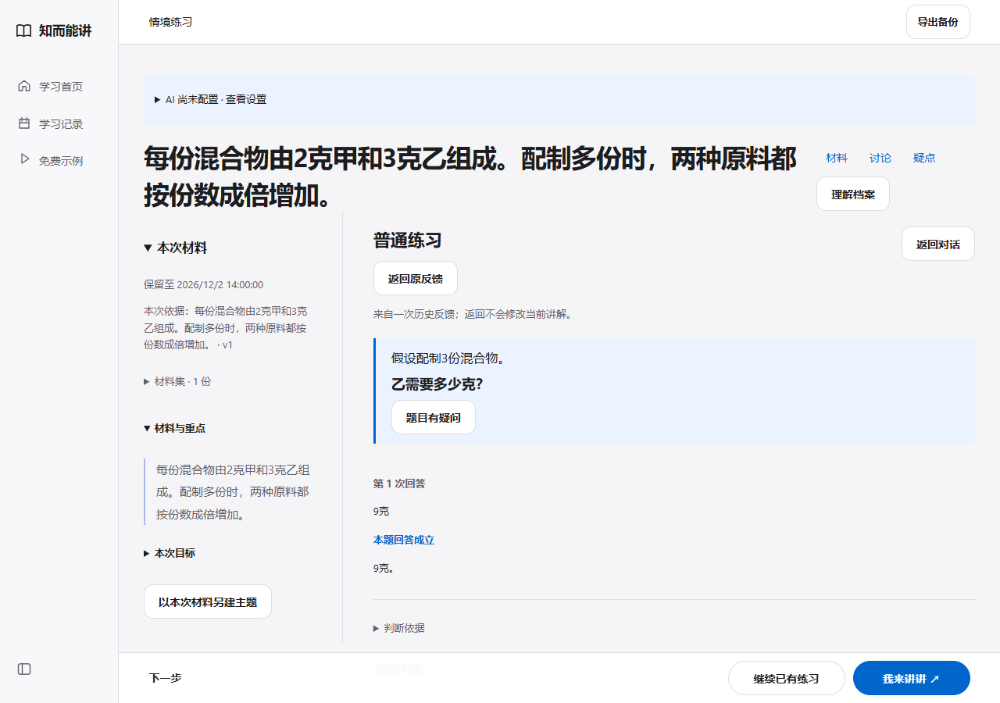
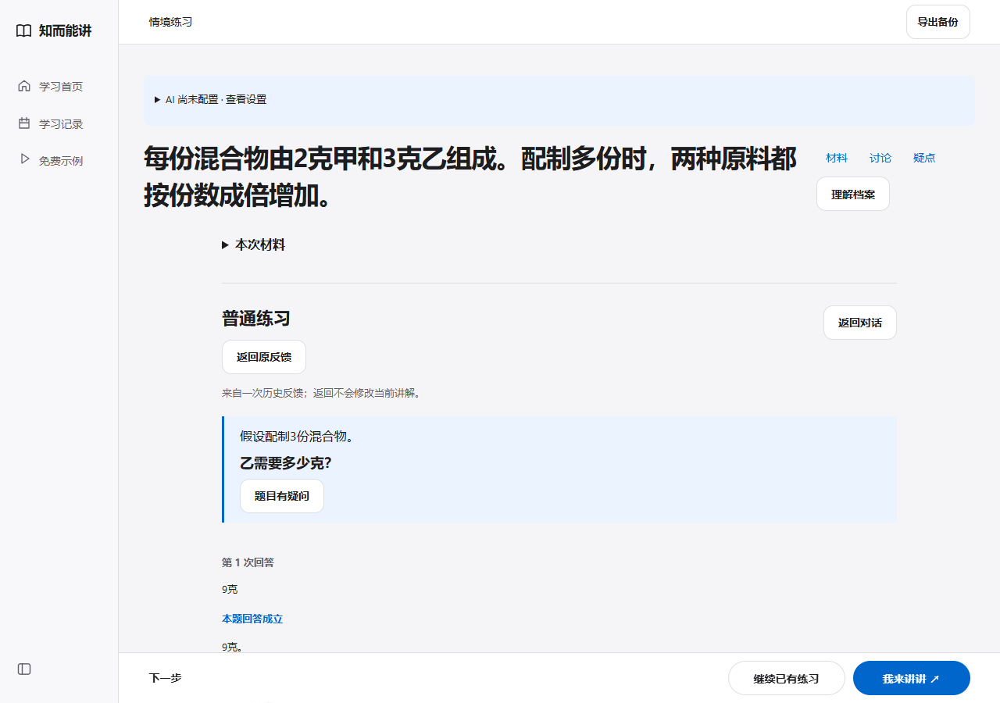

# 普通练习：正文宽度与材料展开状态

从产品分支 `57fad6f` 重开同一个已回答的普通练习。修复仅改样式，不改变题目、首答、自报、反馈或备份格式。

| Windows Edge 158 实页 | 改前 | 改后 |
| --- | --- | --- |
| 1280 × 900，材料展开 | 正文 255 px，右栏空置；材料在第二行、视口下方 | 材料 255 px，正文 770 px，两者顶部对齐 |
| 1280 × 900，收起材料 | 正文仍为 255 px | 正文在同一阅读区，宽 864 px；材料仍可重新展开 |
| 390 × 844，收起材料 | 正文 358 px，无横向溢出 | 正文仍为 358 px，文档宽 390 px；键盘 Enter 从「返回原反馈」进入原反馈 |

原因不是材料节点消失。旧练习样式把材料放到了第二行，把第一行的窄列留给自动排位的正文。移除了旧的材料定位；桌面材料展开时显示双列，收起或不展示时使用单列阅读区。没有新增操作、文案或存储状态。

**核验方式**：隔离的 Windows / Edge 配置，使用合成配比材料，在真实界面保存文字讲解，夹具补入合成历史诊断，作答后关闭并重开同一测试配置。自动断言原题与原回答 ID 不变、普通练习身份不变；切换材料显示、核对实际布局边框并预览截图，再用键盘返回原反馈。时钟偏移为夹具，不是真人次日研究。前后两次没有产品 API POST 或供应商请求。未跑与样式无关的全量回归。

**启动核对**：干净跟踪源码副本，Windows 启动脚本使用 `-SkipBrowser`，未配置 Key。确认本地 4317 健康检查、实际示例路由 `/demo` 返回 200，启动器正常停止自有进程。未声称测试 Explorer 鼠标双击、物理录音或正式灰度。未验证旧程序原地读取新语义；导入备份生成新副本，不是原地降级或保持原期限的证明。
