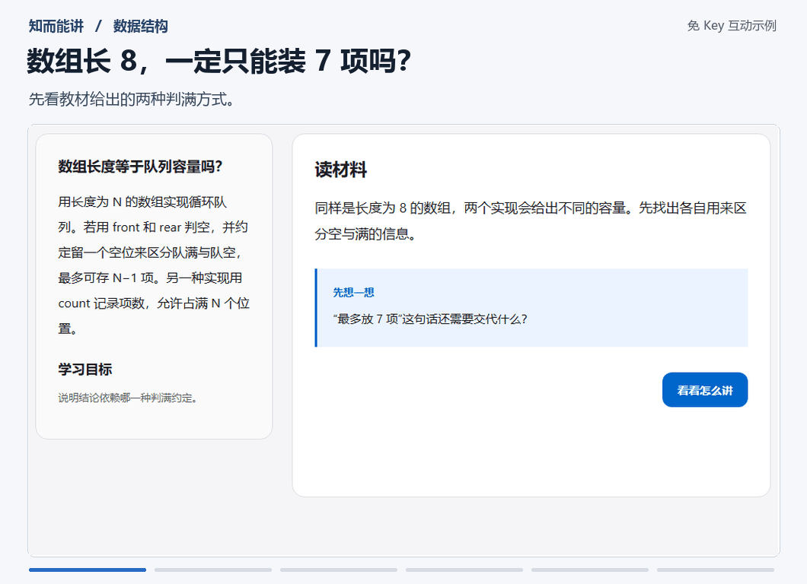

# 讲清一个条件，要留下哪些证据？

一名学生说：“长度为 8 的循环队列只能放 7 项。”在预留空位的实现里，这句话成立。换成用 `count` 判满的实现，结论就变了。知而能讲把这类遗漏留在材料、原讲解和下一次作答之间，学生可以回去核对自己究竟改了哪句话。

这段 31 秒动图来自 Windows Edge 的免 Key 互动示例。示例采用预写反馈，学习者可以自己输入重讲，选择题按选项核对。[静态课程画面](../iterations/v1-experience/demo-course.png) · [在 Windows 上体验](../../README.md#开始使用)

## 从一堆入口，到手上的这条反馈

旧首页先铺开导入方式、限制和学习偏好。改版后，首次打开直接看到材料输入和讲解入口。回访先显示具体的草稿或未完成题目。工作台保留侧栏，把讲解、反馈和“重讲这一点”放在同一视野，原文按需展开。[改版前](../iterations/v1-experience/home-before.png) · [改版后](../iterations/v1-experience/desktop-home.png) · [工作台](../iterations/v1-experience/focused-feedback.png)

正式工作台让 AI 比对当时的材料选段和学习者确认过的解释。举例说，受控门禁案例只讲了实名，漏了签到截止时间。报告可以引用材料里的时间，并标记讲解里未表达。核对时间、局部重讲、再判断 18:05 到达时能否入场，各有自己的记录。题目有歧义时，学习者可以提出复核，暂缓该结论。[理解档案](../iterations/v1-experience/record-desktop.png) · [实现与工程走查](../iterations/2026-11-26-understanding-record.md)

## 一次审核如何改变交互

在短材料里，读完原句就看得见返回按钮；换成 4,026 字的研讨课手册，定位第 32 节的引文时，原按钮远在文末。现在抽屉头始终可见，点一下就回到发起查证的反馈。编辑讲解后，旧报告仍可对照，主按钮旁说明新诊断会发送哪些内容。两处均在 Edge 实页核对。[长材料手机视图](../iterations/v1-experience/long-source-return.png) · [编辑后的桌面视图](../iterations/v1-experience/revised-diagnosis.png) · [代码与审核修复](https://github.com/BenCCCCCCCCC/Chat-Codex-Handoff/pull/47)

## 还要向学习者求证什么

工程走查已经把同一处遗漏从初讲串到新题首答。接下来最值得观察的是，学生能否在没有主持人提示时自行完成这次修正，以及隔一天还能否解释新条件。已准备两工具交叉任务、未公开的平行题和按概念、应用、理由分开的盲评表。目前真实参与者为 0 人。[研究执行包](../research/v1-fieldwork/README.md) · [Windows 候选交付记录](../iterations/2026-11-26-review-delivery.md)
